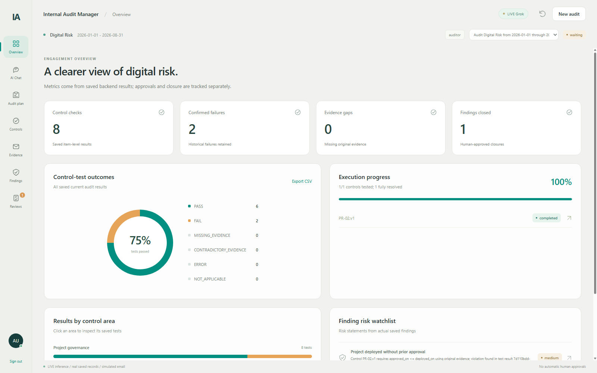
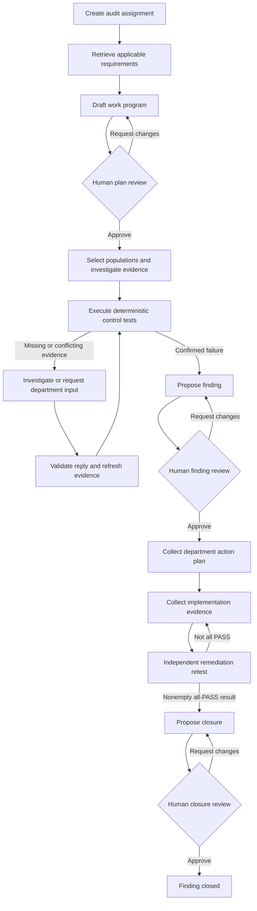
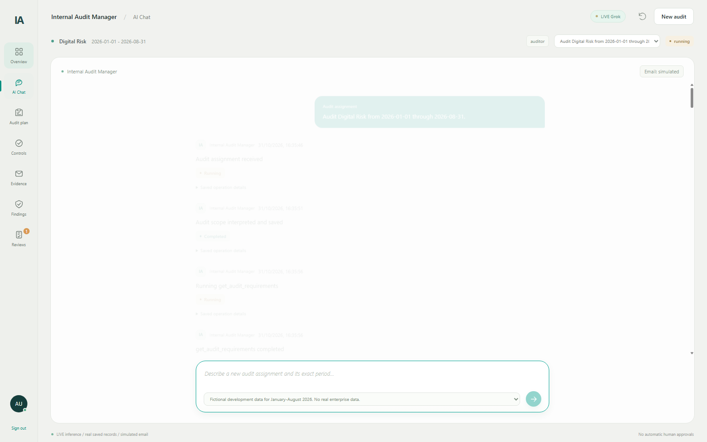
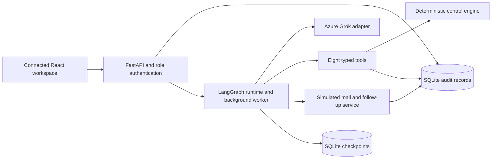

# Internal Audit Manager

### From audit planning to independently verified remediation

A connected audit workspace powered by **Azure Grok**, **LangGraph**, **FastAPI**, and **React**. The agent plans work, investigates evidence, executes control tests, proposes findings, and follows up with departments. People retain approval authority over plans, findings, overdue escalations, and closure.

> **Connected audit workspace.** Model inference is real, audit records are persisted, and email is simulated. The supplied enterprise data is fictional. Real Gmail integration and later phases are outside this release.



[Get started](#getting-started) ? [Audit lifecycle](#the-audit-lifecycle) ? [Findings](#how-findings-are-handled) ? [Remediation](#how-remediation-is-handled) ? [Testing evidence](#testing-and-evaluation-evidence)

## What the system does

| Capability | How it works |
| --- | --- |
| Audit planning | Turns an assignment into a proposed work program based on applicable requirements and controls. |
| Evidence investigation | Searches authorized sources and preserves the source, version, and lineage of evidence. |
| Control testing | Executes deterministic rules against saved populations and evidence; the model does not calculate or invent results. |
| Findings | Proposes exceptions supported by saved failing results, subject to human review. |
| Department follow-ups | Tracks requests, deadlines, reminders, replies, and proposed overdue escalations using simulated email. |
| Remediation | Collects department-owned action plans and implementation evidence, then independently retests before proposing closure. |
| Audit trail | Persists activity, tool receipts, test results, communications, proposal versions, and human decisions. |

## The audit lifecycle



Rejection does not grant permission to proceed. Independent controls can continue while other controls wait for evidence or finding reviews. A pending initial plan prevents execution of its work program.

### 1. Start and approve an audit

An auditor enters an assignment and selects the available development dataset. Grok retrieves requirements and drafts a scoped plan covering controls and a work program. A human can expand, edit, save, approve, reject, or request changes to the proposal.

The approved plan governs subsequent work. Follow-up verification can be explicitly authorized within a reviewed window, normally 30 days after the original audit end when proposed by the agent. Work outside approved bounds requires appropriate scope approval.

The chat composer starts a new audit assignment. Existing work resumes from saved events; it is not an unrestricted conversational assistant.

### 2. Investigate and test controls

For each approved control, the agent retrieves an eligible population, searches evidence, and invokes the testing engine. Rules include approval timing, source-date reconciliation, active employment, MFA, review or scan recency, EDR coverage, and encryption.

| Control outcome | Meaning |
| --- | --- |
| `PASS` | Available evidence satisfies the control rule. |
| `FAIL` | Saved evidence confirms a control exception. |
| `MISSING_EVIDENCE` | Required evidence is unavailable; the exception is not yet confirmed. |
| `CONTRADICTORY_EVIDENCE` | Evidence conflicts and requires investigation or clarification. |
| `ERROR` | The test could not be evaluated successfully. |
| `NOT_APPLICABLE` | The rule does not apply to the evaluated case. |

A missing document is not automatically a confirmed finding. A secondary GRC assertion cannot replace required original approval evidence. A measurable disagreement between GRC and an original approval can itself be a reconciliation exception.

## How evidence and follow-ups are handled

1. **Search first.** The agent checks authorized sources and alternatives before requesting missing evidence.
2. **Create a scoped request.** The request identifies the evidence needed, the department recipient, affected work, deadline, and reminder cadence.
3. **Follow up automatically.** The background worker handles outstanding requests without requiring browser interaction. Default reminders are every three days; scheduling adjusts around deadlines. New requests use a seven-day default deadline unless otherwise specified.
4. **Escalate with approval.** Overdue requests can produce an escalation proposal. A human must approve it before its simulated communication is released.
5. **Validate incoming replies.** The backend checks thread and sender matching and validates structured evidence against the requested source and scope. Incomplete or invalid replies do not resolve the evidence gap.
6. **Resume affected work.** A validated, sufficient reply stops the request's reminders and wakes the dependent audit work. The agent refreshes evidence and creates a new test result.

The UI provides **Prepare synthetic reply** to generate an editable preview. Preparing it does not deliver email, save evidence, or approve anything. Explicitly receiving the reviewed reply sends it through the normal backend validation workflow.

Requests, reminders, incoming replies, delivery receipts, and validation outcomes are persisted. Stable operation identities, a durable outbox, and delivery records prevent duplicate effects during retries and restart recovery. A shared missing document can serve multiple affected controls through one request.

**Email remains simulated.** The system does not connect to Gmail, contact real departments, or extract arbitrary attachments. Replies use normalized structured data.

## How findings are handled

A finding begins as a **proposal**, grounded in saved `FAIL` results for a particular control. It includes a rationale and recommendation tied to the underlying audit records.

- **Human review:** Reviewers can edit permitted fields, save a revision, approve, reject, or request changes.
- **Version protection:** Decisions refer to an exact proposal version. An approval of an outdated version cannot silently approve a newer document.
- **Returned work:** Requested changes remain actionable work for revision; they are not treated as approval or completion.
- **Evidence distinction:** Unresolved missing or contradictory evidence requires investigation rather than an invented confirmed failure.
- **Approved findings:** The agent can move into department action-plan and implementation follow-ups.

The agent cannot approve its own findings. Finding status is derived from saved proposals, decisions, action plans, and closure records. The UI does not invent risk ratings to fill empty fields.

## How remediation is handled

Remediation links an approved finding to a department-owned corrective action and independent verification.

| Step | Responsibility and saved record |
| --- | --- |
| Request an action plan | The agent asks the department for a corrective action after the finding is approved. |
| Record ownership and commitment | The department supplies the responsible owner, planned action, and due date. The agent cannot author the department's commitment as if it came from them. |
| Request implementation evidence | After an action plan exists, the agent requests evidence that the action was implemented. Outstanding requests use the follow-up workflow. |
| Validate the implementation reply | Submitted facts and verification dates must fit the approved scope. A department's claim of completion does not prove effectiveness. |
| Retest independently | The agent obtains a verification population, investigates the new evidence, and runs the control rule again. |
| Propose closure | Closure requires a saved, nonempty remediation run with all results `PASS`, linked to the same finding and control, plus a recorded department action plan. |
| Approve closure | A human reviews the closure proposal. Approval rechecks the supporting records; stale or invalid verification cannot support closure. |

If verification fails, evidence is still missing, or scope is invalid, the closure gate blocks completion. Further evidence or corrective work is needed. **Original failed audit results remain preserved**, even when a later remediation retest passes.

The department action plan's due date is stored separately from evidence-request deadlines. Automated reminders and overdue escalation operate on outstanding department requests; this release does not claim a separate comprehensive action-plan SLA or aging engine.

### What can be tracked

The connected interface exposes the finding, department action plan and owner, committed due date, related communications, verification runs and outcomes, closure proposal, and human review history. Persistent links connect these records so a reviewer can inspect why a finding was raised and what justified its closure.

## The connected workspace

| Section | What you can inspect or do |
| --- | --- |
| **Overview** | View saved metrics, charts, audit progress, and the finding watchlist. |
| **AI Chat** | Submit an audit assignment and follow persisted agent activity and waits. |
| **Audit Plan** | Inspect and review the proposed or approved work program. |
| **Controls & Tests** | Inspect controls, population snapshots, and actual saved test results; export result CSVs. |
| **Evidence Requests** | Inspect evidence details, deadlines, reminders, communication history, and submit explicit synthetic replies. |
| **Findings & Remediation** | Inspect findings, department action plans, independent verification, and closure progress. |
| **Reviews** | Edit permitted proposal fields and make version-aware human decisions with a reason. |



## Architecture and safeguards



Grok chooses permitted operations. Python validates scope, source authority, evidence, role permissions, and approval prerequisites. The model's instructions do not replace backend enforcement.

The eight tools are `get_audit_requirements`, `draft_audit_plan`, `get_test_population`, `search_evidence`, `run_control_test`, `request_department_input`, `propose_finding`, and `manage_remediation`.

- **Roles:** Separate locally configured auditor and reviewer tokens. Auditors can initiate work and submit synthetic replies; reviewers cannot start audits or run agent tools. Human decisions use authenticated review routes.
- **Human gates:** Plans, findings, escalations, and closure require explicit decisions. External messages are untrusted data, not authorization to bypass controls.
- **Traceability:** Evidence, results, inference/tool receipts, activity, and communications retain history. Review documents are versioned.
- **Recovery:** Checkpoints, operation receipts, and worker leases support restart recovery and deduplication. Existing paused sessions remain dormant; this release does not expose general pause/resume controls in the UI.
- **Provider errors:** Transient provider errors receive bounded retries. Persistent failures surface as attention-required work with a saved-work retry action. Azure quota and rate limits still apply.
- **Server operation:** Closing a browser tab does not stop the worker. The backend must remain running for autonomous processing and reminders.

## Getting started

Requires **Python 3.12**, **Node.js with npm**, and an Azure-hosted Grok deployment supporting the configured chat-completions endpoint and tool calling.

### Install and configure

```powershell
python -m venv .venv
.\.venv\Scripts\python.exe -m pip install -r requirements-lock.txt
# Preserve an existing local configuration.
if (!(Test-Path .env)) { Copy-Item .env.example .env }
```

Edit `.env` locally:

| Variable | Purpose |
| --- | --- |
| `AZURE_GROK_CHAT_URL` | Full HTTPS chat-completions URL from the Azure deployment. |
| `AZURE_GROK_DEPLOYMENT` | Actual deployed model/deployment name. |
| `AZURE_GROK_API_KEY` | Private Azure API key. |
| `AUDIT_AUDITOR_TOKEN` | Private token for the auditor role. |
| `AUDIT_REVIEWER_TOKEN` | A different private token for the reviewer role. |
| `EMAIL_MODE` | Keep `simulated` for this release. |
| `AUDIT_DATABASE_PATH` | Local audit database; defaults to `var/audit.sqlite`. |
| `AUDIT_CHECKPOINT_PATH` | Local workflow checkpoints; defaults to `var/checkpoints.sqlite`. |
| `AUDIT_WORKER_ENABLED` | `1` enables automatic background processing. |

`LLM_MODE` is `live`; no runtime mock inference adapter is included. Empty role tokens grant no access. Never commit `.env` or put private credentials into screenshots, issues, or logs.

### Prepare data, build, and run

```powershell
.\.venv\Scripts\python.exe -m scripts.prepare_data
cd frontend
npm ci
npm run build
cd ..
.\.venv\Scripts\python.exe -m uvicorn backend.app:create_app --factory --env-file .env --host 127.0.0.1 --port 8000
```

Open **http://127.0.0.1:8000** and sign in with a locally configured token. Health is available at `/health`; API documentation is at `/docs`. Health reports configuration presence, not a fresh live inference verification.

Data preparation applies migrations and loads the fictional development partition. Server startup does not automatically migrate or seed a database. Repeated imports validate the existing snapshot rather than overwrite conflicting records.

## Sample data

The development dataset includes **three policies, nine controls, eight projects, eight privileged accounts, eight devices, and 71 initial evidence records**. It deliberately includes confirmed control exceptions and a missing original approval.

A separate held-out dataset contains **12 entities and 36 control/entity checks**, covering project governance, privileged access, and endpoint security. It is not loaded into the ordinary workspace by default. Expected labels live under `evaluation/ground_truth/` and are not provided to the runtime agent.

## Testing and evaluation evidence

| Recorded check | Actual result | Proof |
| --- | --- | --- |
| Held-out control-result accuracy | **36/36 (100%)** | [Held-out report](evaluation/heldout_report.md) |
| Held-out real-agent task completion | **3/3 (100%)** | [Case descriptions and limits](evaluation/heldout_report.md#held-out-cases-used) |
| Named component tests | **21 passed, 0 failed** | [Component proof](evaluation/component_test_proof.md) |
| Connected-UI backend regression | **76 passed, 0 failed, 1 NOT RUN** | [Integration report](docs/connected_ui_report.md#validation) and [regression history](evaluation/regression_history.txt) |
| Connected browser workflow | **Passed through human-approved closure** | [Real inference/tool receipts](evaluation/connected_ui_trace.json) and [browser results](frontend/review/connected-browser.json) |

The held-out cases cover approval/risk timing and source reconciliation, privileged account ownership/MFA/reviews, and endpoint protection/scanning/encryption. Correctly identifying a failed control or waiting for missing evidence counts as correct handling; it does not imply that the audited control passed or the finding was automatically approved.

These are **historical results from identified runs**. The held-out sample is small, synthetic, and uses provisional labels. The figures do not guarantee performance on real enterprise data or certify every subsequent source revision. Earlier failures and intentionally unexecuted live checks remain in the logs. Unexecuted live tests are **NOT RUN**, never PASS.

### Run checks locally

```powershell
# Component, integration, and system regression checks without paid model inference.
.\.venv\Scripts\python.exe -m scripts.run_tests
cd frontend
npm test
npm run build
cd ..

# Explicit paid live checks; require configured Azure credentials.
.\.venv\Scripts\python.exe -m scripts.run_tests --live
.\.venv\Scripts\python.exe -m scripts.evaluate_phase4
.\.venv\Scripts\python.exe -m scripts.evaluate_heldout
```

Evaluation drivers use isolated databases. Test-human approvals and generated evaluation records are not imported into the ordinary audit workspace. Historical receipts may reference local paths; their runtime databases are intentionally excluded from the repository.

## Repository guide

| Location | Contents |
| --- | --- |
| `backend/agent/` | Shared LLM interface, Azure adapter, instructions, context, typed tools, and LangGraph orchestration. |
| `backend/services/` | Audit workflow, deterministic testing, approval enforcement, and activity records. |
| `backend/email/` | Simulated communication, deadline-aware follow-ups, incoming validation, and synthetic reply previews. |
| `backend/database/` and `migrations/` | Database schema, validated imports, connections, and versioned migrations. |
| `frontend/` | Current connected React workspace, tests, and browser validation evidence. |
| `data/` | Fictional catalog, authorized contacts, and development/held-out partitions. |
| `tests/` and `scripts/` | Automated checks, data preparation, and explicit live evaluation drivers. |
| `evaluation/` | Ground truth, named test proof, regression logs, and actual evaluation receipts. |
| `docs/` | Architecture decisions, tool contracts, data methodology, and historical implementation reports. |

The standalone mock prototype, superseded UI builds, private configuration, local audit runs, databases, checkpoints, dependencies, and browser profiles are excluded. The [publication manifest](docs/publication_manifest.json) lists the distributed files and their hashes; the manifest excludes its own hash.

Further reading: [Architecture decisions](docs/architecture_decisions.md) ? [Tool design](docs/agent_tool_design.md) ? [Synthetic data](docs/synthetic_data.md) ? [Evaluation methodology](docs/evaluation_methodology.md) ? [Connected UI validation](docs/connected_ui_report.md).
